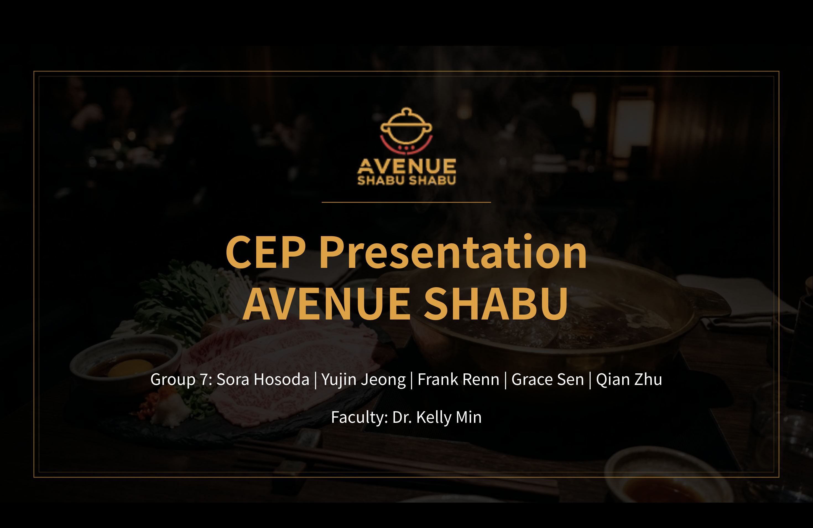
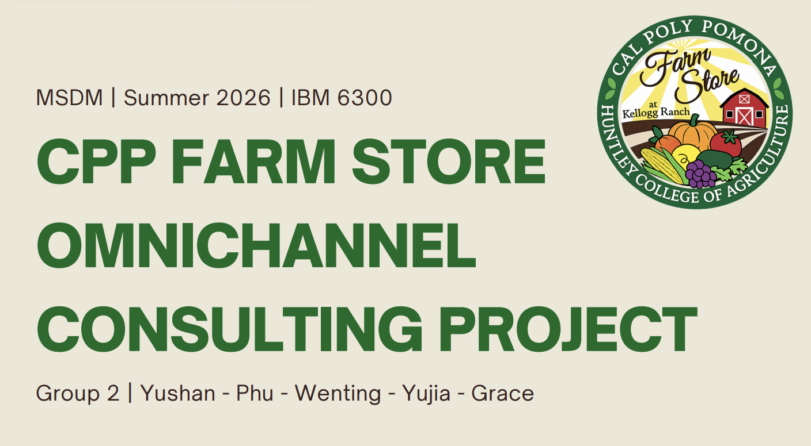
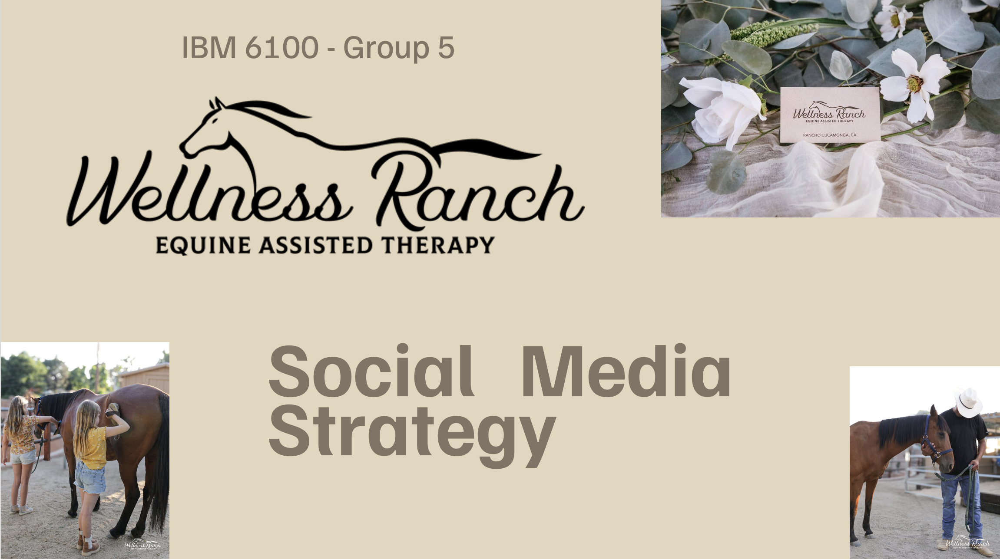
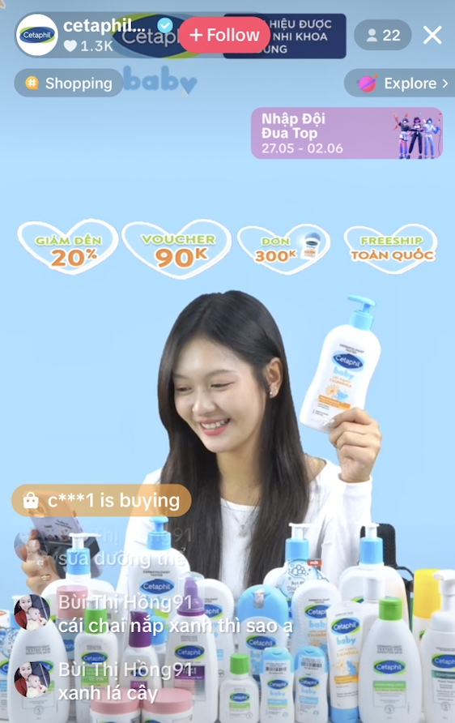
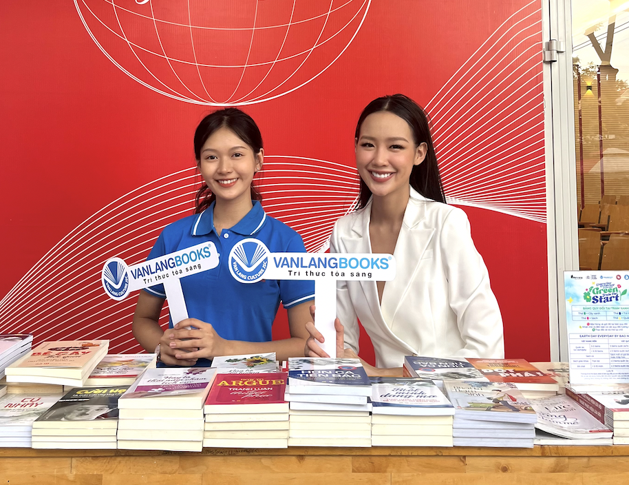

This page features selected academic, client-based, and professional experiences in digital marketing, e-commerce, customer research, and content development.

## Avenue Shabu Client Project

{fig-alt="Avenue Shabu marketing analytics project" fig-align="center" width="50%"}

### Promotion and Marketing Performance

As part of my Culminating Experience Project, I am working with Avenue Shabu to evaluate its marketing activities and identify opportunities to improve sales and profitability.

My assigned area focuses on comparing promotional and non-promotional periods using sales, marketing expense, food cost, labor cost, and campaign information. The planned analysis will use promotional lift, contribution margin, and return on marketing investment to evaluate campaign performance.

Because the project is still in progress, the current work focuses on defining KPIs, reviewing available data, and preparing the analysis plan.

**Skills:** Client consulting, promotion analysis, KPI development, marketing performance measurement, ROMI, and business recommendations.

## CPP Farm Store Project

{fig-alt="CPP Farm Store e-commerce project" fig-align="center" width="50%"}

### E-Commerce and Digital Strategy

This project focused on improving the Farm Store’s digital and e-commerce experience. I helped develop a Shopify prototype, organize product information, and explore how digital analytics could support marketing decisions.

**Skills:** Shopify, Google Merchant Center, GA4, Looker Studio, e-commerce strategy, and customer journey analysis.

------------------------------------------------------------------------

## Wellness Ranch Therapy

{fig-alt="Wellness Ranch Therapy digital marketing project" fig-align="center" width="50%"}

I evaluated Wellness Ranch Therapy’s digital presence and developed recommendations to improve brand awareness, engagement, donations, and client growth.

My work included analyzing performance across TikTok, Instagram, Facebook, and YouTube, as well as reviewing audience segments, competitors, and existing content. I also developed recommendations for email marketing, influencer partnerships, website improvements, Facebook fundraising, and short-form social content.

**Skills:** Social media analytics, content strategy, audience segmentation, email marketing, influencer marketing, competitive analysis, and website strategy.

------------------------------------------------------------------------

# Work Experience

## E-Commerce Livestream Host — OnPoint Vietnam

{fig-alt="E-commerce livestream experience" fig-align="center" width="30%"}

I hosted livestream shopping sessions on Shopee, Lazada, and TikTok Shop. I presented products, communicated promotional offers, and responded to customer questions in real time. Some sessions generated up to approximately \$8,000 in revenue.

**Skills:** Livestream marketing, product presentation, customer engagement, social content, and e-commerce.

## Marketing Intern — Van Lang Culture JSC

{fig-alt="Marketing internship experience" fig-align="center" width="50%"}

I supported promotional events, social media content, and e-commerce marketing activities. My work included helping organize book promotions and environmental campaigns at colleges and universities, as well as managing product and promotional information across digital platforms.

**Skills:** Content creation, social media marketing, promotional support, e-commerce, event management, and team collaboration.
